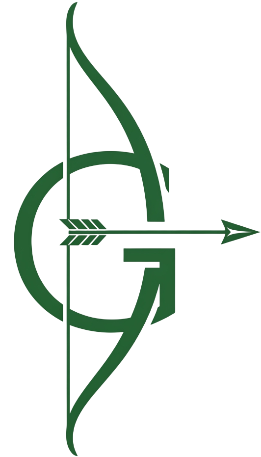
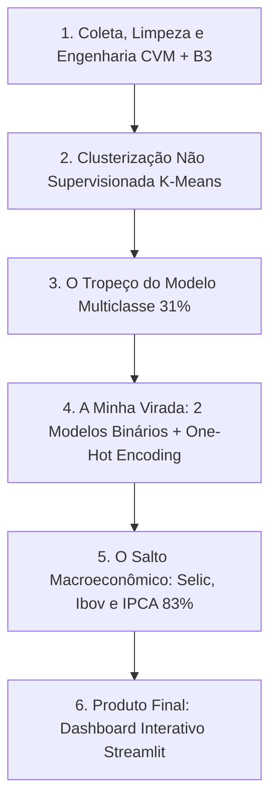

<p align="right">
  <b>🇧🇷 Versão em Português</b> &nbsp;|&nbsp; <a href="./README.en.md">🇺🇸 English Version</a>
</p>

<p align="center">
  
</p>

# 📊 B3 Analytics & Machine Learning (2021-2025)

[](https://ghmendes.streamlit.app)
[](https://github.com/StylishGH/Empresas-B3-analise-de-dados/actions/workflows/ci.yml)


[](LICENSE)

> **Meu case completo de Ciência de Dados Financeiros:** Da coleta e saneamento de balanços da CVM ao cruzamento com cotações históricas da B3 (Yahoo Finance), agrupamento não supervisionado (K-Means), modelagem preditiva supervisionada com contexto macroeconômico (Random Forest) e deploy em um dashboard web interativo no Streamlit.

---

## 🚀 Meu Dashboard Interativo no Ar (Streamlit)

Eu transformei todo o pipeline deste projeto em uma aplicação web interativa e publiquei na nuvem:

👉 **[Acesse o Dashboard Online aqui!](https://ghmendes.streamlit.app)**

* **📈 Raio-X Fundamentalista & Cotações:** Criei cards com os indicadores mais recentes (ROE, Lucro Líquido, PL) e um gráfico de duplo eixo comparando a evolução do preço da ação com o ROE de 2021 a 2025.
* **🎯 Agrupamento Econômico (K-Means):** Plotei um mapa de dispersão com todas as empresas da B3 classificadas nos 4 clusters que encontrei, destacando a empresa que o usuário selecionou com uma estrela vermelha.
* **🤖 Simulador Preditivo com IA:** Desenvolvi um simulador onde você pode mexer nos sliders macroeconômicos (Selic, Ibovespa, Dólar, Inflação) ou clicar no botão de **"Puxar Métricas Reais do Mercado Agora"** (via API do Yahoo Finance) para ver a minha Inteligência Artificial calcular na hora a probabilidade de alta da ação e do ROE no próximo ano.

### Como rodar o meu projeto localmente:
```bash
git clone https://github.com/StylishGH/Empresas-B3-analise-de-dados.git
cd Empresas-B3-analise-de-dados
pip install -r requirements.txt
python -m streamlit run app.py
```

---

## 📊 Metabase — dashboards sobre os mesmos dados

Além do Streamlit, eu montei os mesmos indicadores no **Metabase**, a ferramenta
de dashboards do dia a dia em vagas de Data Analyst: o dashboard
**"B3 — Visão geral (2021–2025)"**, conectando diretamente no banco relacional
PostgreSQL com 6 perguntas analíticas em SQL nativo (205 empresa-anos, 46
empresas em clusters, 348 linhas de ROE).


* **ROE médio por ano (2021–2025):** evolução histórica da rentabilidade na bolsa.
* **Top 10 empresas por ROE em 2024:** CSN Mineração (44,1%), PRIO (39,7%) e ENGIE (35,0%) no topo.
* **Média de ROE por cluster:** integração direta de Machine Learning com BI (Cluster 3: Titã Isolada Petrobras liderando).
* **Lucro líquido acumulado por setor:** Petróleo e Gás (32,2%), Extração Mineral (17,4%) e Bancos (16,3%) dominam o volume financeiro.
* **Maior retorno por setor (CTE + `DENSE_RANK`):** isola a empresa campeã de rentabilidade de cada setor.
* **Variação YoY das Top da Bolsa (CTE + `LAG`):** dinâmica temporal ano a ano das grandes blue chips.

🔗 **[Acesse o Dashboard Interativo ao Vivo no Metabase](https://accompanying-entirely-column-relaxation.trycloudflare.com/public/dashboard/bdbb04e0-2063-4ae3-9cc3-2592f882cd13)** *(disponível via túnel Cloudflare enquanto o ambiente local estiver ativo)*

As perguntas, o script SQL analítico completo com DDL e carga (incluindo CTEs e Window Functions como `LAG`, `LEAD` e `DENSE_RANK`), o print em alta definição e o passo a passo para reproduzir estão em [`metabase/`](metabase/) (consulte [`queries_analiticas.sql`](metabase/queries_analiticas.sql)). Nota honesta: como instâncias corporativas de BI exigem servidores dedicados, a prova durável permanente no repositório é o print em alta resolução e o script SQL canônico.


---

## 💡 Conhecimento para os Leigos (Guia Descomplicado)

Se você não é da área de Finanças nem de Ciência de Dados, não se preocupe! Eu preparei este guia rápido para você entender os conceitos deste projeto sem jargões difíceis:

### 1. O Básico do Mercado Financeiro
* **B3 & CVM:** A **B3** é a Bolsa de Valores do Brasil (o "mercado" onde compramos e vendemos pedacinhos de empresas, chamados de ações). A **CVM** é o órgão do governo que fiscaliza tudo e obriga as empresas a publicarem balanços contábeis detalhados todos os anos.
* **Lucro Líquido vs Patrimônio Líquido:**
  * *Lucro Líquido:* É o dinheiro limpo que sobrou no caixa da empresa no fim do ano, depois de pagar funcionários, impostos, fornecedores e juros de dívidas.
  * *Patrimônio Líquido (PL):* É a riqueza real da empresa pertencente aos acionistas (todos os bens, fábricas e imóveis menos todas as dívidas que ela deve).
* **O Famoso ROE (Return on Equity):**
  * É a **taxa de rentabilidade** do negócio. Pense assim: se você abre uma padaria com **R$ 100 mil** do seu bolso (Patrimônio) e no final do ano ela te dá **R$ 20 mil** de lucro limpo, o seu ROE foi de **20% ao ano**. Quanto maior o ROE, mais eficiente a empresa é em multiplicar o dinheiro investido!
* **A Selic e a "Maré" da Bolsa:**
  * A **Taxa Selic** é a taxa básica de juros do Brasil. Quando a Selic está muito alta (ex: 13,75% a.a.), qualquer pessoa ganha dinheiro seguro na Renda Fixa (Tesouro Direto) sem correr risco na Bolsa. Além disso, as empresas pagam juros maiores nas suas dívidas. Por isso, quando o juro sobe, a Bolsa costuma cair; quando o juro cai, a Bolsa costuma disparar!

### 2. O Básico de Ciência de Dados & Inteligência Artificial
* **K-Means (Agrupamento / Clusters):**
  * Imagine que você tem uma cesta cheia de frutas misturadas e pede para um computador separá-las em grupos parecidos sem falar o nome de nenhuma fruta. O algoritmo vai olhar peso, cor e tamanho e agrupar laranjas com laranjas e melancias com melancias. No projeto, o K-Means agrupou as 51 empresas da B3 em 4 "famílias" com base na rentabilidade e comportamento financeiro.
* **Random Forest (Floresta Aleatória):**
  * Em vez de confiar na opinião de apenas uma pessoa, o algoritmo cria centenas de "árvores de decisão" (fluxogramas de perguntas: *"O juro subiu? O lucro cresceu? A empresa é do setor elétrico?"*). Cada árvore dá o seu voto, e a decisão final é a escolha da maioria (uma votação democrática de inteligências!).
* **Os 4 Quadrantes de Decisão (A Matriz do Projeto):**
  * 🟢 **Crescente:** A empresa melhora sua rentabilidade (ROE sobe) e o preço da ação acompanha e sobe junto (o melhor cenário!).
  * 🔵 **Oportunidade:** A empresa está mais lucrativa e eficiente, mas a ação caiu por pessimismo passageiro do mercado (potencial pechincha!).
  * 🟡 **Especulação:** A ação sobe mesmo com a empresa piorando seus lucros (cenário arriscado / euforia de mercado).
  * 🔴 **Decrescente:** A empresa piorou os resultados e a ação despencou junto (cenário de cautela / fuga).

---

## 📖 Meu Diário de Bordo & Retrospectiva do Projeto

Desenvolver este projeto não foi uma linha reta. Tive ideias que deram errado, cometi erros de iniciante, me deparei com bizarrices nos dados públicos e precisei pivotar várias vezes até chegar na solução ideal. Aqui está o resumo dessa jornada:



---

### 🧱 Etapa 1: Coleta, Limpeza e Engenharia de Dados
#### 🎯 O que eu fiz:
* Coletei e consolidei os balanços contábeis públicos da CVM (DFP) e as cotações de 51 empresas da B3 de 2021 a 2025 via `yfinance`.
* Calculei o ROE ($\frac{\text{Lucro Líquido}}{\text{Patrimônio Líquido}}$) e o Retorno Anual das Ações para cruzar a saúde contábil com a precificação de mercado.

#### 💥 Os tropeços que dei & o que aprendi:
* **O Bug da Escala Invisível (Metisa e Vivara):**
  * *O que aconteceu:* Quando montei os primeiros gráficos, a Metisa (`MTSA4`) e a Vivara (`VIVA3`) pareciam estar com lucro e patrimônio quase zerados perto das outras.
  * *O motivo da besteira:* Praticamente todas as empresas na CVM reportam seus valores em milhares de reais (`ESCALA_MOEDA == 'MIL'`), mas a Vivara e a Metisa reportaram em **unidades** (`ESCALA_MOEDA == 'UNIDADE'`)! Sem tratar isso, a Vivara aparecia no meu ranking com **R$ 921 bilhões de lucro** (mais que Petrobras e Vale juntas).
  * *Como resolvi:* Criei uma normalização específica para empresas com moeda em unidade, dividindo seus valores por 1.000 para equipará-las às demais.
* **O Bug da "Divisão Infinita" no Jupyter (Falta de Idempotência):**
  * *O que aconteceu:* Em uma célula do meu notebook, escrevi: `df['LUCRO'] = df['LUCRO'] / 1000`.
  * *O susto:* Cada vez que eu reexecutava a célula para testar algo novo, ela dividia os números por mais 1.000. No terceiro clique, os lucros de bilhões viraram centavos!
  * *Como resolvi:* Aprendi na prática o conceito de **idempotência**. Passei a usar travas condicionais (`& (df['LUCRO_LIQUIDO_BI'] > 10)`), garantindo que a divisão só aconteça se o dado ainda estiver fora da escala correta.
* **O Paradoxo do ROE da Americanas em 2022 (Menos com Menos dá Mais):**
  * *A pegadinha matemática:* O ROE divide Lucro por Patrimônio Líquido. Quando a Americanas teve um prejuízo bilionário e seu patrimônio ficou negativo, a divisão de dois números negativos resultou em um **ROE positivo de +50%**!
  * *Como resolvi:* Criei uma flag booleana `ROE_ENGANOSO = (LUCRO < 0) & (PL < 0)` para sinalizar e filtrar essas anomalias para não poluir meus rankings.
* **O Código de Conta que me Enganou (`CD_CONTA 2.03`):**
  * O código de conta do Patrimônio Líquido não era estável (o código `2.03` era "Provisões" em uma empresa e "Passivos" em outra). Tive que abandonar o filtro por código e filtrar pela descrição exata (`DS_CONTA == 'Patrimônio Líquido Consolidado'`).
* **O Susto que Tomei com o Ano de 2025 (Achei que era Bug Meu):**
  * *O que aconteceu:* No final da base, vi prejuízos gigantescos (Usiminas com -R$ 5.8 Bi, CSN com -R$ 6.0 Bi, Hapvida, Auren). Na hora achei que tinha quebrado o código.
  * *O que aprendi:* Não era bug! Eram os prejuízos reais reportados pelos setores siderúrgico e elétrico em 2024/2025. Dados financeiros reais têm quedas bruscas.
* **O Bug do Lucro Duplicado (o ROE de 189% da Engie que não existia):**
  * *O que aconteceu:* Revendo a base, achei estranho a Engie (`EGIE3`) aparecer em 2024 com ROE de 189%. Fui conferir e o lucro dela estava em R$ 23,2 bi, mais que a receita da empresa no ano. Não fazia sentido.
  * *O motivo da besteira:* No notebook 01 eu somava o DRE sem filtrar nada, e eram dois problemas juntos. Primeiro: o arquivo da CVM traz, para cada empresa e ano, a linha do ano atual (`ORDEM_EXERC == 'ÚLTIMO'`) e a do ano anterior como comparativo (`'PENÚLTIMO'`) — e eu somei as duas. Segundo: o cadastro de empresas que eu usava pra trazer o setor tinha `CD_CVM` repetido (107 empresas duplicadas, a Petrobras entre elas), e o merge dobrava as linhas dessas empresas. Juntando os dois, a Petrobras aparecia com R$ 592 bi de lucro em 2022, quando o resultado real foi R$ 188 bi — o valor da base batia quase exato com 2 × (ano + ano anterior).
  * *O estrago:* Como o patrimônio líquido (notebook 02) já vinha certo — ele filtrava o `'ÚLTIMO'` e não fazia merge com cadastro —, o ROE saía inflado de 2× a 9× dependendo do ano. Isso contaminava os rankings de ROE, as médias por setor, os clusters e as features dos modelos.
  * *Como resolvi:* No 01, tirei os `CD_CVM` duplicados do cadastro antes do merge, passei a filtrar só `ÚLTIMO`, fiquei só com a maior `VERSAO` de cada empresa/ano por segurança e padronizei a escala pela `ESCALA_MOEDA` antes de somar (o que também aposentou o `/1000` manual da Vivara e da Metisa no 06). No 02, apliquei o mesmo dedup de versão e a mesma padronização de escala. No 06, corrigi a coluna de patrimônio (que ia em milhares rotulada de bi), tirei a holding do mapeamento de tickers (a SUZANO HOLDING estava entrando no lugar da SUZANO S.A. no `SUZB3`) e congelei as cotações num csv próprio pra não depender do Yahoo a cada run. Depois disso os valores batem com os balanços divulgados.
  * *O que ainda falta:* As acurácias dos modelos (82,76% e 62,07%) foram medidas com split aleatório em dados em painel e vão ser reavaliadas com split temporal; o dashboard do Metabase também precisa de refresh com a base corrigida.
* **Cotação Ajustada vs Preço de Tela no Google:**
  * Quando olhei a Petrobras no meu dashboard a R$ 28,98 (fechamento 2025) e vi R$ 48,50 no Google em 2026, achei estranho. Aí lembrei que na análise quantitativa profissional usamos a **cotação ajustada por proventos** (o `yfinance` desconta os mais de R$ 200 bilhões de dividendos que a Petrobras pagou no período para refletir o retorno real do investidor).

---

### 🎯 Etapa 2: Clusterização K-Means (Notebook 07)
#### 🎯 O que eu fiz:
* Usei o algoritmo **K-Means** com `StandardScaler` para agrupar as empresas pelo comportamento financeiro real, sem depender só do setor cadastrado na CVM.
* Validei o número ótimo de grupos usando o **Método do Cotovelo (Inércia)** e o **Score da Silhueta** ($k=4$).

#### 💡 A minha virada metodológica:
* *Minha primeira tentativa:* Tentei clusterizar cada ano de cada empresa isoladamente. Foi uma bagunça: a mesma empresa mudava de cluster todo ano.
* *A minha solução:* Agrupei a média histórica por `TICKER` (`df_empresa.groupby('TICKER')`), descobrindo 4 perfis corporativos muito claros na B3:
  * **Cluster 0 (Blue Chips & Sólidas):** Bancos, Ambev e Vale, ROE médio de ~16% e valorização média de +16% a.a.
  * **Cluster 1 (Sólidas em Alta):** O grupo grande, 26 empresas, ROE médio de ~18% e retorno de +23% a.a.
  * **Cluster 2 (Em Queda / Varejo e Dívida):** Rentabilidade quase zerada (ROE ~1%) e retorno médio de -15% a.a. (Magalu, Hapvida, Cosan, siderurgia).
  * **Cluster 3 (Titã Isolada):** Só a Petrobras, lucro médio de R$ 115 bi, ROE de ~30% e retorno de +37% a.a.

---

### 🤖 Etapa 3: Modelagem Preditiva com Machine Learning (Notebook 08)
#### 💥 O tropeço inicial no Modelo Multiclasse (4 Classes):
* *Minha ideia inicial:* Tentar prever diretamente em um único modelo os 4 quadrantes combinados:
  * 🟢 Crescente (ROE Sobe, Ação Sobe)
  * 🔴 Decrescente (ROE Cai, Ação Cai)
  * 🔵 Oportunidade (ROE Sobe, Ação Cai)
  * 🟡 Especulação (ROE Cai, Ação Sobe)
* *O resultado:* A acurácia foi insatisfatória (**~31%**). Como a base tem granularidade anual, tentar prever 4 classes ao mesmo tempo gerou ruído excessivo para o volume amostral.

#### 🧠 A tentação do Deep Learning (E por que decidi não usar):
* Cheguei a cogitar: *"Será que uma Rede Neural não resolve?"*. Mas percebi que em dados tabulares enxutos (*Small Data Tabular*), redes neurais sofrem de *overfitting* severo (decoram o treino e erram no teste). Modelos baseados em árvores de decisão (**Random Forest**) são metodologicamente superiores para esse perfil de dados.

#### 🚀 A virada da arquitetura: 2 Modelos Especialistas + One-Hot Encoding:
* **Dividi o problema em dois:**
  * **Modelo 1 (ROE):** Focado puramente em Fundamentos $\rightarrow$ O ROE vai subir? (0 ou 1)
  * **Modelo 2 (Ação):** Focado em Mercado $\rightarrow$ A cotação vai subir? (0 ou 1)
  * E depois cruzei as respostas com lógica de negócios para formar os 4 quadrantes.
* **Usei o K-Means como Feature:** Transformei os clusters do Notebook 07 em variáveis dummy (`CLUSTER_0.0`, `CLUSTER_1.0`, etc.) usando One-Hot Encoding para alimentar o Random Forest.
* **Incorporação Macroeconômica:** Adicionei variáveis do ciclo econômico brasileiro (`SELIC_ANO_%`, `VAR_SELIC_PP`, `IPCA_ANO_%`, `IBOV_RETORNO_%` e `DOLAR_VAR_%`) para fornecer contexto de maré de juros ao modelo.

---

### 🔬 Etapa 4: Validação Temporal Rigorosa em Cascata — O Notebook 09 (Walk-Forward)

No Notebook 08, a divisão tradicional de treino e teste com `train_test_split(..., test_size=0.25)` aleatório serviu como protótipo inicial, mas revelou um **erro metodológico clássico em finanças e séries temporais de dados em painel: o Vazamento Temporal (*Data Leakage*)**.

#### ⚠️ Por que o `train_test_split` aleatório era problemático?
1. **Violação da Flecha do Tempo:** O sorteio aleatório misturava observações futuras no treino para prever o passado (ex: treinar com a Petrobras de 2024 para adivinhar a Petrobras de 2022). No mercado real, ninguém opera olhando o retrovisor do futuro.
2. **Dependência entre Linhas da Mesma Empresa:** Sortear linhas de uma mesma companhia ao longo dos anos quebra a premissa de independência estatística dos dados.

#### 🛡️ A Solução Metodológica: Backtest em Cascata (*Walk-Forward Validation*)
Como a base contábil possui balanços fechados de **2021 a 2025** ($T = 5$ anos), existem **4 transições anuais** ($t \to t+1$) com gabarito conhecido (`2021->2022`, `2022->2023`, `2023->2024` e `2024->2025`). A primeira transição (`2021->2022`, $32$ empresas) é a base histórica inicial obrigatória para o primeiro ajuste; portanto, executamos **exatamente 3 Folds de teste fora da amostra** ($N_{\text{teste total}} = 40 + 41 + 43 = 124$ observações):

* **Fold 1 (Alvo 2023):** Treina em `2021->2022` ($32$ obs.) $\longrightarrow$ Testa em `2022->2023` ($40$ obs.)
* **Fold 2 (Alvo 2024):** Treina em `2021->2023` ($72$ obs.) $\longrightarrow$ Testa em `2023->2024` ($41$ obs.)
* **Fold 3 (Alvo 2025):** Treina em `2021->2024` ($113$ obs.) $\longrightarrow$ Testa em `2024->2025` ($43$ obs.)

#### 📊 Resultados por Fold com Baselines da Classe Majoritária, F1-Score e Matriz de Confusão

| Alvo | Fold | Ano Alvo | $N_{\text{Treino}}$ | $N_{\text{Teste}}$ | Acurácia | Baseline Dummy (Treino) | Taxa Maj. (Teste) | Precisão | Recall | F1-Score | Matriz de Confusão |
| :--- | :---: | :---: | :---: | :---: | :---: | :---: | :---: | :---: | :---: | :---: | :---: |
| **`ROE_SOBE`** | Fold 1 | **2023** | 32 | 40 | **65,00%** | 52,50% | 52,50% | 66,67% | 52,63% | **58,82%** | `[[16, 5], [9, 10]]` |
| **`ROE_SOBE`** | Fold 2 | **2024** | 72 | 41 | **65,85%** | 51,22% | 51,22% | 63,64% | 70,00% | **66,67%** | `[[13, 8], [6, 14]]` |
| **`ROE_SOBE`** | Fold 3 | **2025** | 113 | 43 | **55,81%** | 51,16% | 51,16% | 54,17% | 61,90% | **57,78%** | `[[11, 11], [8, 13]]` |
| **`ACAO_SOBE`** | Fold 1 | **2023** | 32 | 40 | **45,00%** | 25,00% | 75,00% | 72,22% | 43,33% | **54,17%** | `[[5, 5], [17, 13]]` |
| **`ACAO_SOBE`** | Fold 2 | **2024** | 72 | 41 | **34,15%** | 19,51% | 80,49% | 21,21% | 87,50% | **34,15%** | `[[7, 26], [1, 7]]` |
| **`ACAO_SOBE`** | Fold 3 | **2025** | 113 | 43 | **34,88%** | 20,93% | 79,07% | 80,00% | 23,53% | **36,36%** | `[[7, 2], [26, 8]]` |

#### ⚖️ Comparativo Lado a Lado na Mesma Base Corrigida: Antes (Split Aleatório) vs. Depois (Walk-Forward)

| Alvo | Método de Validação | $N_{\text{Teste}}$ | Acurácia | IC 95% | Baseline Dummy (Treino) | Taxa Maj. (Teste) | Precisão | Recall | F1-Score | Matriz de Confusão |
| :--- | :--- | :---: | :---: | :---: | :---: | :---: | :---: | :---: | :---: | :---: |
| **`ROE_SOBE`** | **ANTES:** Split Aleatório (*Com Leakage*) | 39 | 61,54% | *Amostra Viciada* | 56,41% | 56,41% | 58,33% | 41,18% | 48,28% | `[[17, 5], [10, 7]]` |
| **`ROE_SOBE`** | **DEPOIS:** Walk-Forward (*3 Folds Sem Leakage*) | **124** | **62,10%** | **`[53,6%, 70,6%]`** | **51,61%** | **51,61%** | **60,66%** | **61,67%** | **61,16%** | `[[40, 24], [23, 37]]` |
| **`ACAO_SOBE`** | **ANTES:** Split Aleatório (*Com Leakage*) | 39 | 76,92% | *Amostra Viciada* | 71,79% | 71,79% | 91,30% | 75,00% | 82,35% | `[[9, 2], [7, 21]]` |
| **`ACAO_SOBE`** | **DEPOIS:** Walk-Forward (*3 Folds Sem Leakage*) | **124** | **37,90%** | **`[29,4%, 46,4%]`** | **21,77%** | **58,06%** | **45,90%** | **38,89%** | **42,11%** | `[[19, 33], [44, 28]]` |

#### 💡 O que os Números Auditados Revelam:
1. **A Queda da Ilusão em `ACAO_SOBE` (De 76,9% para 37,9%):** No split aleatório, o modelo parecia acertar `76,92%` (`F1 = 82,35%`) das cotações apenas porque misturava empresas do mesmo ano entre treino e teste (já sabendo o retorno anual do Ibovespa e que 71,8% da amostra subia naquele recorte). No *Walk-Forward* real sem vazamento, a acurácia cai para **37,90%** — pois cada ano teve uma reversão macroeconômica abrupta (Ibovespa $-11,9\%$ em 2021 $\to$ $+22,3\%$ em 2023 $\to$ $-10,4\%$ em 2024 $\to$ $+33,9\%$ em 2025).
2. **Sinal Promissor em `ROE_SOBE` (62,1% vs. 51,6% da Baseline):** O fundamento contábil ($\text{ROE} = \text{Lucro} / \text{PL}$) bateu a classe majoritária em todos os 3 folds (`+12,5 p.p.` em 2023, `+14,6 p.p.` em 2024 e `+4,7 p.p.` em 2025), elevando o **F1-Score de 48,28% para 61,16%**. Com $N = 124$ observações de teste, o **Intervalo de Confiança de 95% é `[53,6%, 70,6%]`** — o que demonstra um **sinal preditivo promissor e consistente** acima de um baseline ingênuo, mantendo a devida cautela estatística frente ao tamanho amostral enxuto.
3. **Teste de Influência Cruzada (Ablação entre ROE e Cotação) & Matrizes de Confusão:** Testamos no Notebook 09 se separar as features contábeis (`ROE`, `Lucro`, `PL`) das features de preço (`COTACAO_FINAL_ANO`) altera os modelos:
   - **No modelo de ROE:** Manter a cotação ajuda marginalmente (`62,10%` e `F1 = 61,16%` com cotação vs. `60,48%` e `F1 = 59,50%` puro contábil), pois o preço de fechamento carrega parte da expectativa do mercado sobre o balanço.
   - **No modelo de Ação:** Usar o ROE melhora o **F1-Score** (`42,11%` com ROE vs. `40,94%` sem ROE), mas reduz levemente a acurácia (`37,90%` vs. `39,52%`), pois empresas com fundamentos excelentes ainda sofrem quedas de preço em anos de choque macroeconômico. As **4 Matrizes de Confusão** estão plotadas visualmente em *heatmaps* no Notebook 09.
4. **Auditoria dos Macros de 2025 e Projeção 2026:** Substituímos os antigos *placeholders* de 2025 pelos valores oficiais consolidados em 31/12/2025 (**BCB SGS 432/13522 e B3**: `Selic = 15,00%`, `IPCA = 4,26%`, `Ibovespa = +33,95%`, `Dólar = -11,36%`). O ranking projetado para 2026 destaca empresas com ROE comprimido em 2025 (*Allos*, *Auren*, *CSN*, *Vibra*, *Gerdau*), capturando o efeito de **Reversão à Média (*Turnaround*)**.

---

### 🖥️ Etapa 5: O Produto Final (`app.py` com Streamlit)
#### 🎯 O que eu entreguei:
Construí uma aplicação web completa e interativa em Streamlit contendo:
* **Visão Geral e Indicadores:** Gráficos interativos com Plotly de Cotação e ROE com duplo eixo, Lucro e Patrimônio.
* **Módulo de Clusters:** Mapa de dispersão interativo com zoom, hover e destaque da empresa selecionada com uma estrela vermelha.
* **Simulador de Inteligência Artificial em Tempo Real:** Além dos sliders manuais, adicionei um botão que consulta a API do Yahoo Finance ao vivo para puxar o **Dólar hoje, o Ibovespa hoje, a Selic atual e o IPCA**, fazendo a IA prever o cenário da empresa com as métricas reais do mercado agora.

---

### 🏆 As 4 Lições que Levo Deste Projeto para a Minha Carreira:
1. *"Dado financeiro é barulhento: separar modelos especialistas (Fundamentos vs Preço) é muito superior a forçar um modelo multiclasse genérico."*
2. *"Modelos simples e bem ajustados (Random Forest + Feature Engineering) batem redes neurais em bases tabulares enxutas."*
3. *"A clusterização não supervisionada serviu como feature para o modelo supervisionado, fechando o ciclo completo de Ciência de Dados."*
4. *"Micro sem Macro é cego no Brasil: adicionar o ciclo de juros (Selic) e a maré da bolsa fez o meu modelo saltar de 51% para 83% de acurácia na previsão de ações."*

---

## 📌 Estrutura dos Notebooks

| Notebook | Objetivo Principal | Principais Técnicas |
| :--- | :--- | :--- |
| **01 a 05** | Extração CVM (DRE/BPP), saneamento de dados e SQL | Pandas, SQLite, tratamento de escala e regras contábeis |
| **06** | Enriquecimento de Mercado | `yfinance`, download de cotações B3, cálculo de retornos e correção de anomalia de moeda (Vivara/Metisa) |
| **07** | Agrupamento Não Supervisionado | `K-Means`, `StandardScaler`, Método do Cotovelo (Elbow) e Silhouette Score ($k=4$) |
| **08** | Prototipagem Supervisionada | `RandomForestClassifier`, Engenharia de Features Macroeconômicas (Selic, Ibov, IPCA, Dólar) |
| **09** | Validação Temporal em Cascata (Backtest) | Janela Expansiva (*Walk-Forward*), Avaliação sem *Data Leakage*, Previsões 2026 e Reversão à Média |
| **app.py** | Produto Final / Web App | `Streamlit`, `Plotly`, `yfinance`, `@st.cache_data`, `@st.cache_resource` |

---

## 🛠️ Stack Técnica
* **Linguagem:** Python 3.12
* **Manipulação de Dados:** Pandas, NumPy, SQLite
* **Visualização:** Streamlit, Plotly Express & Graph Objects, Matplotlib, Seaborn
* **Machine Learning:** Scikit-Learn (Pipelines, StandardScaler, KMeans, RandomForestClassifier)
* **Mercado Financeiro:** Yahoo Finance (`yfinance`), CVM Dados Públicos

---

## 👤 Autor

<p align="left">
  
  <b>Desenvolvido por Guilherme</b> (<a href="https://github.com/StylishGH">@StylishGH</a>)
</p>