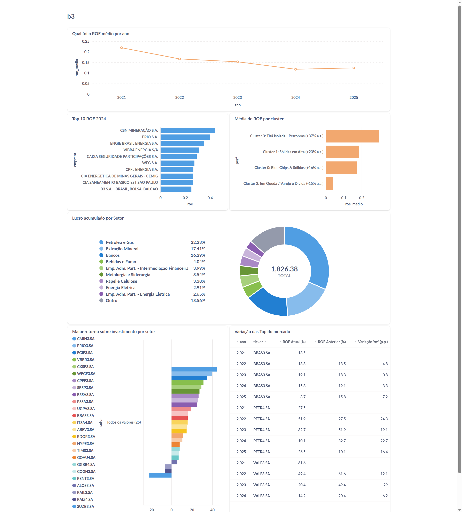

# Metabase — Dashboards & SQL Analítico sobre a B3

Prova prática do uso do **Metabase** (ferramenta padrão de BI/Self-Service em empresas e fintechs, como a BMP) integrado a um banco relacional **PostgreSQL**, sobre os dados contábeis consolidados da B3 em `data/processed`.

🔗 **Acesse o Dashboard Interativo ao Vivo (Link Público):**
👉 **[Abrir Dashboard no Metabase (Cloudflare Tunnel)](https://accompanying-entirely-column-relaxation.trycloudflare.com/public/dashboard/bdbb04e0-2063-4ae3-9cc3-2592f882cd13)**

O arquivo canônico com **toda a estrutura DDL, carga e queries SQL comentadas** (desde agregações até Window Functions complexas) está em:
👉 [`queries_analiticas.sql`](queries_analiticas.sql)



---

## 1. As Perguntas Principais do Dashboard

Todas rodam sobre o banco `b3` (PostgreSQL), tabelas `dados_consolidados` (205 empresa-anos), `clusters` (46 empresas) e `roe` (348 linhas), carregadas dos CSVs limpos através da Parte 0 de [`queries_analiticas.sql`](queries_analiticas.sql).

### Perguntas Básicas (Agregações & JOINs)
1. **ROE médio por ano (2021–2025)** — Linha.
   ```sql
   SELECT ano, ROUND(AVG(roe), 4) AS roe_medio 
   FROM dados_consolidados 
   GROUP BY ano ORDER BY ano;
   ```
2. **ROE médio por cluster de empresas** — Barras. JOIN com `clusters` para conectar o aprendizado não-supervisionado ao BI.
   ```sql
   SELECT c.perfil, ROUND(AVG(d.roe), 4) AS roe_medio 
   FROM dados_consolidados d
   JOIN clusters c ON c.ticker = d.ticker 
   GROUP BY c.perfil ORDER BY roe_medio DESC;
   ```
3. **Top 10 empresas por ROE em 2024** — Barras horizontais.
   ```sql
   SELECT empresa, ticker, ROUND(roe * 100, 1) AS roe_pct 
   FROM dados_consolidados 
   WHERE ano = 2024 AND roe IS NOT NULL 
   ORDER BY roe DESC LIMIT 10;
   ```
4. **Lucro líquido total por setor (2021–2025)** — Barras.
   ```sql
   SELECT setor, ROUND(SUM(lucro_liquido_bi), 2) AS lucro_total_bi 
   FROM dados_consolidados
   GROUP BY setor ORDER BY lucro_total_bi DESC;
   ```

---

## 2. Perguntas Avançadas (CTEs & Window Functions)

Para extrair inteligência analítica profunda sem colapsar as linhas das empresas:

1. **Top 1 Empresa de Rentabilidade por Setor (CTE + `DENSE_RANK`)**:
   Ranqueia e isola a campeã de cada setor econômico em 2024.
   ```sql
   WITH ranking_setorial AS (
       SELECT ano, setor, ticker, roe,
              DENSE_RANK() OVER (PARTITION BY ano, setor ORDER BY roe DESC) AS rank_setor
       FROM dados_consolidados WHERE roe IS NOT NULL
   )
   SELECT setor, ticker, ROUND(roe * 100, 1) AS roe_pct
   FROM ranking_setorial WHERE ano = 2024 AND rank_setor = 1 ORDER BY roe_pct DESC;
   ```

2. **Market Share de Lucro nos Bancos (CTE + `SUM() OVER ()`)**:
   Mede a concentração do lucro líquido dos bancos em 2024 sem perder a granularidade individual.
   ```sql
   WITH lucro_bancos AS (
       SELECT ticker, lucro_liquido_bi,
              SUM(lucro_liquido_bi) OVER () AS total_bancos_bi
       FROM dados_consolidados
       WHERE ano = 2024 AND setor = 'Bancos' AND lucro_liquido_bi > 0
   )
   SELECT ticker, ROUND(lucro_liquido_bi, 2) AS lucro_bi,
          ROUND((lucro_liquido_bi / total_bancos_bi) * 100, 1) AS market_share_pct
   FROM lucro_bancos ORDER BY lucro_bi DESC;
   ```

3. **Aceleração Temporal Ano a Ano — YoY (CTE + `LAG`)**:
   Analisa a variação em pontos percentuais do ROE em relação ao ano anterior.
   ```sql
   WITH serie_yoy AS (
       SELECT ano, ticker, roe,
              LAG(roe, 1) OVER (PARTITION BY ticker ORDER BY ano) AS roe_anterior
       FROM dados_consolidados
   )
   SELECT ano, ticker, ROUND(roe * 100, 1) AS roe_atual_pct,
          ROUND((roe - roe_anterior) * 100, 1) AS delta_yoy_pp
   FROM serie_yoy WHERE ticker IN ('PETR4.SA', 'VALE3.SA', 'WEGE3.SA', 'BBAS3.SA')
   ORDER BY ticker, ano;
   ```

4. **Spread Relativo vs. Média do Setor (CTE + `AVG() OVER (PARTITION BY ...)`)**:
   Mede quantos pontos percentuais acima ou abaixo da média do setor a empresa performou.

---

## 3. Como Reproduzir o Ambiente

Para subir o banco de dados e o Metabase localmente com um único comando:

```bash
# Executa o script que sobe o PostgreSQL via Docker e o Metabase na porta 3001:
./metabase/start_metabase.sh
```

Acesse no navegador: **http://localhost:3001**

Configuração do banco no Metabase:
- **Tipo:** PostgreSQL
- **Host:** `localhost` | **Porta:** `5432`
- **Banco:** `b3` | **Usuário:** `postgres` | **Senha:** `postgres`
